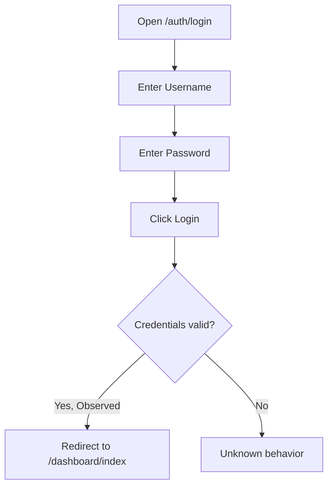
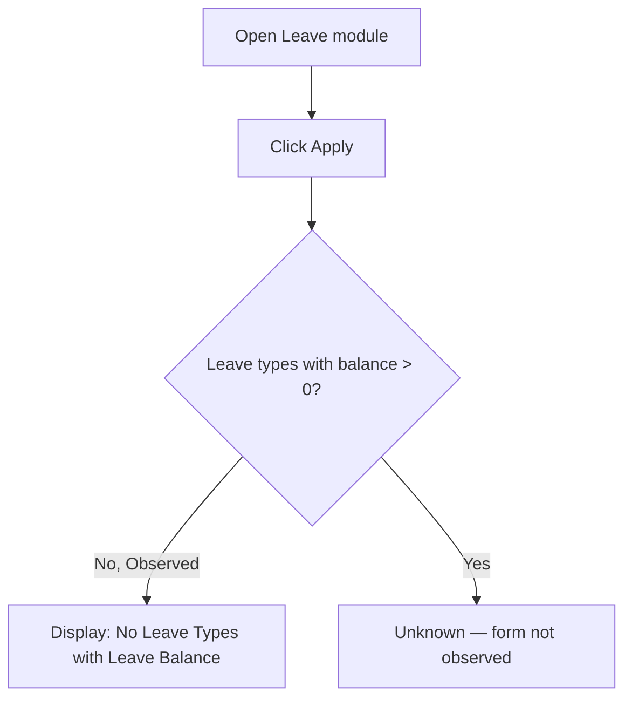
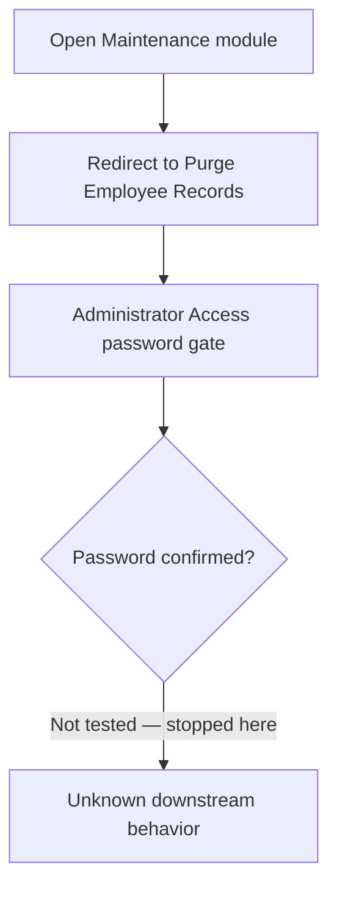

# Product Requirements Document: OrangeHRM (Open Source Demo)

## 1. Document Information

| Field | Value |
|---|---|
| Project Name | OrangeHRM (OrangeHRM OS 5.9 — Open Source HR Management System) |
| Project URL | https://opensource-demo.orangehrmlive.com/web/index.php/auth/login |
| Document Purpose | Evidence-based PRD derived from live exploration of the public OrangeHRM demo instance, for use by QA, engineering, product, and business stakeholders. |
| Generated Date | 2026-09-14 |
| Analysis Scope | Live login page; authenticated Admin-role exploration of Dashboard, Admin, PIM, Leave, Time, Recruitment, My Info, Performance, Directory, Maintenance (entry screen only), Claim, and Buzz modules; the account/user dropdown menu. |
| Analysis Limitations | Single role explored live (Admin/ESS-admin combined account). The Maintenance > Purge Employee Records module requires a secondary password re-confirmation screen; per safety rules this was not passed, so purge functionality itself is Unknown. No ESS-only or other role's session was available, so role-specific restricted views are Inferred/Unknown rather than Observed. Configuration sub-screens (Job, Organization, Qualifications, Nationalities, Corporate Branding under Admin; Entitlements/Reports/Configure under Leave; Attendance/Reports/Project Info under Time; Configuration under Recruitment/Performance/Claim) were seen listed in navigation but not all were opened in detail. No official product documentation or source repository was consulted — all findings are from live observation only, this being a fully authenticated live demo instance. |

## 2. Analysis Methodology

- **Playwright MCP availability:** Confirmed available in this session (`mcp__playwright__browser_*` tools). Used as the primary and sole exploration mechanism.
- **Live browser exploration performed:** Yes, exclusively via Playwright MCP. No `WebFetch`/`curl`/raw HTTP inspection was used at any point; all findings are `Observed` via rendered pages and real navigation.
- **Application type:** The login page and all interior pages are server-rendered HTML with client-side enhancement (React-based admin UI, evidenced by dynamic dropdowns/comboboxes and SPA-like route transitions under a single `/web/index.php/...` router). No empty SPA shell was encountered — content was present on first load throughout.
- **Pages/routes explored:** `/auth/login`, `/dashboard/index`, `/admin/viewSystemUsers` (+ Add User form), `/pim/viewEmployeeList`, `/leave/viewLeaveList`, `/leave/applyLeave`, `/time/viewEmployeeTimesheet`, `/recruitment/viewCandidates`, `/pim/viewPersonalDetails/empNumber/7` (My Info), `/performance/searchEvaluatePerformanceReview`, `/directory/viewDirectory`, `/maintenance/purgeEmployee` (entry/password-confirmation screen only), `/claim/viewAssignClaim`, `/buzz/viewBuzz`, plus the account dropdown menu.
- **Authentication:** The login page itself displays the demo credentials in plain text ("Username: Admin / Password: admin123") as an intentional feature of this public demo instance. These documented, self-disclosed credentials were used to log in. No third-party or guessed credentials were used. All functionality behind login was explored live as the Admin user.
- **Documentation/source used:** None. All findings are based solely on live observation of the running demo application.
- **Observed vs. Inferred vs. Unknown:** The large majority of this document is `Observed` (rendered UI, real navigation, real forms/tables). A small number of items are `Inferred` (e.g., generalizing a pattern seen on one module's search/table UI to describe the overall UI paradign) and are labeled as such. Anything behind the Maintenance module's second password gate, and any role other than the demo Admin account, is `Unknown`.

## 3. Product Overview

**Observed:** OrangeHRM is a web-based Human Resource Management System (HRMS). The publicly hosted demo (branded "OrangeHRM OS 5.9") provides modules for administering system users, managing employee personal/employment records (PIM), leave requests and approvals, time tracking/timesheets, recruitment/candidate pipeline, a personal "My Info" self-service area, performance review tracking, an employee directory, system maintenance (including a guarded employee-record purge tool), expense claims, and an internal social feed ("Buzz"). A persistent left sidebar exposes all modules; a top banner shows breadcrumb-style module/sub-module headings, an "Upgrade" call-to-action linking to OrangeHRM's paid "Advanced" offering, and an account menu.

**Apparent purpose / value proposition (Observed + Inferred):** The product centralizes core HR operations — headcount records, leave administration, attendance/time tracking, recruitment, performance reviews, and internal communication — in a single system, aimed at small-to-mid-size organizations (Inferred from the "Upgrade to Advanced" upsell pattern typical of open-core products, and from the module breadth covering full employee lifecycle).

**Target domain (Observed):** Human Resources / Human Capital Management software.

## 4. Product Goals

### Confirmed Goals (Observed)
- Provide centralized management of employee master data (PIM module: personal, contact, emergency contact, dependents, immigration, job, salary, report-to, qualifications, memberships).
- Support end-to-end leave management: applying for leave, viewing/searching leave requests by status/date/employee, and assigning leave on behalf of employees.
- Support time tracking via timesheets, with a "Timesheets Pending Action" queue.
- Support recruitment tracking: candidates linked to vacancies, hiring managers, application status, and application method.
- Support performance review tracking (Employee Reviews search/list, with review status and due dates).
- Support an employee directory searchable by name, job title, and location.
- Support expense claim submission, tracking, and administrative assignment.
- Support internal social communication via a "Buzz" newsfeed (posts, likes, comments, shares, photo/video sharing).
- Provide administrative control over system user accounts (create/enable/disable/assign role, tied to an employee record).
- Provide a guarded, re-authentication-protected path to a "critical Administrator function" (observed for Purge Employee Records).

### Inferred Goals
- Reduce administrative overhead of HR processes by digitizing what would otherwise be manual/paper-based workflows (Inferred from the breadth of forms/lists mirroring classic HR paperwork).
- Serve as an evaluation/demo vehicle to upsell users to "OrangeHRM Advanced" (Inferred from the persistent "Upgrade" button in the top banner across all modules).

## 5. Target Users and Personas

| Persona | Description | Responsibilities (Observed/Inferred) | Main Goals | Accessible Functionality |
|---|---|---|---|---|
| System/HR Administrator | The role of the logged-in demo account ("Admin" user role, tied to employee "manda user", job title "HR Manager" per Buzz anniversary widget) | Manage system user accounts, employee master data, leave assignment, recruitment pipeline, claims assignment, maintenance functions | Keep employee and system data accurate; administer access | All modules observed: Admin, PIM, Leave, Time, Recruitment, My Info, Performance, Directory, Maintenance (gated), Claim, Buzz |
| Employee (ESS — Employee Self-Service) | Inferred from the "ESS" User Role value seen for most non-Admin system users in the User Management list (e.g., "Francesca Towne", "Roberto Schowalter") | Presumed: view/update own personal info, apply for leave, submit timesheets, submit claims, post to Buzz | Presumed: self-service HR interactions | Unknown — not verified live (no ESS credentials available); Inferred to be a restricted subset of the Admin's accessible modules based on typical "My Info"/self-service framing observed in the sidebar |
| Hiring Manager | Named as a column/field value in Recruitment > Candidates ("Hiring Manager") | Presumed: reviews assigned candidates | Presumed: manage assigned recruitment pipeline | Unknown — not verified live |
| Supervisor | Named as a filter field in PIM Employee List ("Supervisor Name") and a tab in My Info ("Report-to") | Presumed: oversees direct reports | Presumed: approve leave/timesheets for reports | Unknown — not verified live |

## 6. User Roles and Permissions

**Observed directly:** The System Users table (Admin > User Management) exposes a "User Role" column with two values actually present in the data: **Admin** and **ESS**. The Add User form requires selecting "User Role*" from a dropdown (options not enumerated — dropdown was not expanded) and a "Status*" dropdown (values not enumerated, but the table shows "Enabled"/"Disabled" as the two live statuses).

| Role | Evidence | Accessible Modules (Observed for Admin; Unknown for ESS) | Confidence |
|---|---|---|---|
| Admin | System Users table rows with Role = "Admin" (e.g., username "Admin", "HelloTest103") | All 12 sidebar modules: Admin, PIM, Leave, Time, Recruitment, My Info, Performance, Dashboard, Directory, Maintenance, Claim, Buzz | High (Observed) |
| ESS | System Users table rows with Role = "ESS" (majority of the 14+ listed users) | Unknown — not verified live under an ESS session | Low (Inferred role exists; permissions Unknown) |

No role-permission matrix beyond the two observed role labels could be constructed, since only the Admin role was authenticated live. A formal Admin-vs-ESS permission matrix is `Unknown`.

## 7. Product Modules

| Module | Purpose | Key Screens (Evidence route) | Main Functionality | Related Roles | Confidence |
|---|---|---|---|---|---|
| Dashboard | Landing page summarizing time, actions, quick links, social feed, and org distribution | `/dashboard/index` | Widgets: Time at Work (punch status), My Actions (pending approvals/interviews), Quick Launch (shortcuts), Buzz Latest Posts, Employees on Leave Today, Employee Distribution by Sub Unit, Employee Distribution by Location | Admin (Observed); Unknown for ESS | High |
| Admin | System user and org configuration management | `/admin/viewSystemUsers`, `/admin/saveSystemUser` | Search/filter/list/add/edit/delete system users; sub-navigation for Job, Organization, Qualifications, Nationalities, Corporate Branding, Configuration (present in nav, not opened in depth) | Admin only (Inferred — module named "Admin") | High for User Management; Medium for unopened sub-tabs |
| PIM (Personnel Information Management) | Employee master-data management | `/pim/viewEmployeeList` | Search/filter employees (name, ID, status, supervisor, job title, sub unit); paginated list (158 records observed); Add Employee; per-employee record editing | Admin | High |
| My Info | Self-service view of the logged-in user's own employee record | `/pim/viewPersonalDetails/empNumber/7` | Tabs: Personal Details, Contact Details, Emergency Contacts, Dependents, Immigration, Job, Salary, Report-to, Qualifications, Memberships; editable Personal Details form with Custom Fields and Attachments sub-sections | All authenticated users (Inferred — module is "My Info", implying self-scope) | High for Personal Details tab; Medium for other tabs (present but not opened) |
| Leave | Leave request lifecycle management | `/leave/viewLeaveList`, `/leave/applyLeave` | Leave List search (by date range, status, type, employee, sub unit); Apply for leave (blocked for this account: "No Leave Types with Leave Balance"); My Leave, Entitlements, Reports, Configure, Assign Leave (present in nav) | Admin (Assign Leave); presumed Employee (Apply/My Leave) | High for Leave List; Medium for unopened sub-tabs |
| Time | Timesheet and attendance tracking | `/time/viewEmployeeTimesheet` | Select Employee to view timesheet; "Timesheets Pending Action" queue (3 records observed) with per-timesheet "View"; Attendance, Reports, Project Info present in nav | Admin/Supervisor (Inferred from "pending action" queue) | High for Timesheets tab; Medium for Attendance/Reports/Project Info |
| Recruitment | Candidate and vacancy pipeline tracking | `/recruitment/viewCandidates` | Search/filter candidates (job title, vacancy, hiring manager, status, name, keywords, application date range, method of application); paginated candidate list (61 records) with Vacancy, Candidate, Hiring Manager, Date of Application, Status columns; Add candidate; per-row actions (view/edit/delete/shortlist-style icons vary by row); Vacancies tab present in nav | Admin/Hiring Manager | High |
| Performance | Performance review tracking | `/performance/searchEvaluatePerformanceReview` | Employee Reviews search (name, job title, sub unit, current-employees-only toggle, review status, date range); results table (Employee, Job Title, Sub Unit, Review Period, Due Date, Review Status); Configure, My Trackers, Employee Trackers present in nav | Admin/Manager | High for Manage Reviews; Medium for Trackers tabs |
| Directory | Company-wide employee lookup | `/directory/viewDirectory` | Search by employee name, job title, location; card-style results list (162 records) showing name, job title, sub unit, location where populated | All authenticated users (Inferred — general lookup tool) | High |
| Maintenance | Administrative/critical system functions | `/maintenance/purgeEmployee` | Re-authentication gate ("Administrator Access") requiring password confirmation before proceeding to Purge Employee Records; not passed further per safety constraints | Admin only | Medium (gate observed; functionality beyond it Unknown) |
| Claim | Expense claim submission and administration | `/claim/viewAssignClaim` | Employee Claims search (name, reference ID, event name, status, date range, current-employees toggle); results table (Reference ID, Employee, Event Name, Description, Currency, Submitted Date, Status, Amount) with "View Details"; Assign Claim action; Submit Claim, My Claims, Employee Claims, Configuration present in nav | Admin (Assign/view all); presumed Employee (Submit/My Claims) | High |
| Buzz | Internal social/communication feed | `/buzz/viewBuzz` | Post composer ("What's on your mind?", Share Photos, Share Video); feed sorted by Most Recent/Most Liked/Most Commented; per-post like/comment/share counts and actions; "Upcoming Anniversaries" side panel | All authenticated users (Inferred — social feed) | High |

## 8. Functional Requirements

| ID | Module | Requirement | User/Actor | Priority | Evidence | Confidence |
|---|---|---|---|---|---|---|
| FR-001 | Authentication | The system shall allow a user to log in with a username and password. | Any user | Must | Login page, `/auth/login` | High (Observed) |
| FR-002 | Authentication | The system shall provide a "Forgot your password?" recovery path from the login screen. | Any user | Should | Login page link "Forgot your password?" | High (Observed presence; flow not exercised) |
| FR-003 | Dashboard | The system shall display a Dashboard summarizing the current user's time, pending actions, shortcuts, latest social posts, employees on leave, and org distribution charts. | Authenticated user | Must | `/dashboard/index` | High (Observed) |
| FR-004 | Admin | The system shall allow searching system users by Username, User Role, Employee Name, and Status. | Admin | Must | `/admin/viewSystemUsers` search panel | High (Observed) |
| FR-005 | Admin | The system shall allow creating a new system user with User Role, Employee Name, Status, Username, Password, and Confirm Password. | Admin | Must | Add User form (`/admin/saveSystemUser`) | High (Observed) |
| FR-006 | Admin | The system shall allow editing and deleting existing system users from the list via per-row actions. | Admin | Must | Action icon buttons per row in System Users table | Medium (Observed icons; edit/delete flow not exercised) |
| FR-007 | PIM | The system shall allow searching employees by Name, Employee Id, Employment Status, Supervisor Name, Job Title, and Sub Unit, with an "Include: Current Employees Only" toggle. | Admin | Must | `/pim/viewEmployeeList` search panel | High (Observed) |
| FR-008 | PIM | The system shall allow adding a new employee record. | Admin | Must | "Add" button on Employee List | Medium (Observed button; add flow not exercised) |
| FR-009 | PIM / My Info | The system shall allow viewing and editing an employee's Personal Details (name, employee ID, other ID, driver's license number/expiry, nationality, marital status, date of birth, gender) and Custom Fields (e.g., Blood Type, Test_Field). | Admin (any employee); self for My Info | Must | `/pim/viewPersonalDetails/empNumber/7` | High (Observed) |
| FR-010 | PIM / My Info | The system shall allow attaching files to an employee record. | Admin/self | Should | Attachments section with "Add" button on Personal Details tab | Medium (Observed UI; upload not exercised) |
| FR-011 | Leave | The system shall allow searching leave requests by From/To Date, Status ("Show Leave with Status", required), Leave Type, Employee Name, and Sub Unit, with an "Include Past Employees" toggle. | Admin | Must | `/leave/viewLeaveList` search panel | High (Observed) |
| FR-012 | Leave | The system shall allow an employee to apply for leave, restricted to leave types for which the employee has an available balance. | Employee | Must | `/leave/applyLeave` showing "No Leave Types with Leave Balance" for this account | High (Observed constraint; full apply flow not exercised due to no balance) |
| FR-013 | Leave | The system shall allow an Admin/Supervisor to assign leave on behalf of an employee. | Admin | Must | "Assign Leave" nav item under Leave module | Medium (Observed nav entry; form not opened) |
| FR-014 | Time | The system shall allow selecting an employee to view their timesheet. | Admin/Supervisor | Must | "Select Employee" panel on `/time/viewEmployeeTimesheet` | High (Observed) |
| FR-015 | Time | The system shall display a queue of "Timesheets Pending Action" with employee name and timesheet period, each with a View action. | Admin/Supervisor | Must | Table with 3 records on Timesheets page | High (Observed) |
| FR-016 | Recruitment | The system shall allow searching candidates by Job Title, Vacancy, Hiring Manager, Status, Candidate Name, Keywords, Date of Application range, and Method of Application. | Admin | Must | `/recruitment/viewCandidates` search panel | High (Observed) |
| FR-017 | Recruitment | The system shall track candidate status through named stages including at least "Application Initiated", "Shortlisted", and "Rejected". | Admin | Must | Status column values in Candidates table | High (Observed) |
| FR-018 | Recruitment | The system shall allow adding a new candidate. | Admin | Should | "Add" button on Candidates page | Medium (Observed button; flow not exercised) |
| FR-019 | Performance | The system shall allow searching employee performance reviews by Employee Name, Job Title, Sub Unit, Review Status, Date range, and a Current-Employees-Only toggle. | Admin/Manager | Must | `/performance/searchEvaluatePerformanceReview` search panel | High (Observed) |
| FR-020 | Performance | The system shall display each review's Employee, Job Title, Sub Unit, Review Period, Due Date, and Review Status. | Admin/Manager | Must | Employee Reviews table column headers | High (Observed) |
| FR-021 | Directory | The system shall allow searching the employee directory by Employee Name, Job Title, and Location. | Authenticated user | Must | `/directory/viewDirectory` search panel | High (Observed) |
| FR-022 | Directory | The system shall display directory results as employee cards with name, and job title/sub unit/location where available. | Authenticated user | Should | Directory card list (162 records) | High (Observed) |
| FR-023 | Maintenance | The system shall require re-entry of the current user's password before granting access to critical Administrator functions such as Purge Employee Records. | Admin | Must | "Administrator Access" gate at `/maintenance/purgeEmployee` | High (Observed gate; downstream function Unknown) |
| FR-024 | Claim | The system shall allow searching expense claims by Employee Name, Reference Id, Event Name, Status, and Date range, with a Current-Employees-Only toggle. | Admin | Must | `/claim/viewAssignClaim` search panel | High (Observed) |
| FR-025 | Claim | The system shall display each claim's Reference Id, Employee Name, Event Name, Description, Currency, Submitted Date, Status, and Amount, with a "View Details" action. | Admin | Must | Employee Claims table (3 records) | High (Observed) |
| FR-026 | Claim | The system shall allow an Admin to assign a new claim to an employee. | Admin | Must | "Assign Claim" button on Claim page | Medium (Observed button; form not opened) |
| FR-027 | Buzz | The system shall allow authenticated users to post free-text updates to a company-wide social feed, optionally with photos or video. | Authenticated user | Should | Post composer on `/buzz/viewBuzz` | High (Observed) |
| FR-028 | Buzz | The system shall allow liking, commenting on, and sharing individual Buzz posts, and display counts for each. | Authenticated user | Should | Like/Comment/Share icons and counts per post | High (Observed) |
| FR-029 | Buzz | The system shall allow sorting the Buzz feed by Most Recent Posts, Most Liked Posts, or Most Commented Posts. | Authenticated user | Could | Sort buttons above the feed | High (Observed) |
| FR-030 | Buzz | The system shall display upcoming employee work-anniversaries in a side panel. | Authenticated user | Could | "Upcoming Anniversaries" panel | High (Observed) |
| FR-031 | Account | The system shall provide an account menu with About, Support, Change Password, and Logout options. | Authenticated user | Must | Account dropdown menu (top-right) | High (Observed) |
| FR-032 | Global | Nearly every module's search results table shall support sortable columns (indicated by up/down sort icons) and, where the record count exceeds a page size, pagination. | Authenticated user | Should | Sort icons on Admin/PIM/Recruitment/Performance/Claim tables; pagination controls on PIM (4 pages) and Recruitment (2 pages) | High (Observed) |

## 9. User Stories

| ID | Story |
|---|---|
| US-001 | As an Admin, I want to search system users by username, role, employee name, or status, so that I can quickly locate an account to manage. |
| US-002 | As an Admin, I want to add a new system user tied to an employee record, so that a new employee can log in to the system. |
| US-003 | As an Admin, I want to search and filter the employee list by multiple criteria, so that I can find a specific employee record among many. |
| US-004 | As an authenticated user, I want to view and edit my own Personal Details in "My Info", so that my HR record stays accurate. |
| US-005 | As an employee, I want to apply for leave only from leave types where I have an available balance, so that I cannot request leave I am not entitled to. |
| US-006 | As an Admin/Supervisor, I want to see which timesheets are pending action, so that I can review and approve them in a timely manner. |
| US-007 | As an Admin, I want to filter candidates by vacancy, hiring manager, and status, so that I can track the hiring pipeline for open roles. |
| US-008 | As a Manager, I want to search performance reviews by status and due date, so that I can track outstanding evaluations. |
| US-009 | As any employee, I want to search the company directory by name, job title, or location, so that I can find and contact a colleague. |
| US-010 | As an Admin, I want to be prompted to re-enter my password before purging employee records, so that destructive actions are protected against accidental or unauthorized use. |
| US-011 | As an Admin, I want to view and assign expense claims, so that submitted claims are processed and tracked. |
| US-012 | As an authenticated user, I want to post updates and react to colleagues' posts on Buzz, so that I can engage with company-wide communication. |
| US-013 | As an authenticated user, I want to change my password from the account menu, so that I can maintain account security without contacting an administrator. |

## 10. User Flows

### Flow: Login
- **Actor:** Any user with valid credentials
- **Preconditions:** User has a valid username/password (the demo instance publishes "Admin"/"admin123" directly on the login page).
- **Main flow:** User navigates to `/auth/login` → enters Username → enters Password → clicks Login → system redirects to `/dashboard/index`.
- **Alternative flows:** User clicks "Forgot your password?" (not exercised in this session).
- **Error/exception flows:** Unknown — invalid-credential behavior was not tested (out of scope to avoid interfering with the shared public demo).
- **Expected outcome:** Authenticated session with Dashboard displayed.



### Flow: Apply for Leave (as observed for this account)
- **Actor:** Employee (Admin account used in this session)
- **Preconditions:** User is authenticated.
- **Main flow:** User opens Leave module → clicks "Apply" → system checks the employee's leave-type balances → if none available, displays "No Leave Types with Leave Balance" and no form is rendered.
- **Alternative flows:** Unknown — behavior when at least one leave type has balance was not observed (this account had none).
- **Error/exception flows:** None observed.
- **Expected outcome (for this account):** No leave application form is shown; user is informed no eligible leave types exist.



### Flow: Access Maintenance / Purge Employee Records (partial — stopped at gate)
- **Actor:** Admin
- **Preconditions:** User is authenticated as Admin.
- **Main flow:** User opens Maintenance module → system redirects to `/maintenance/purgeEmployee` → system displays "Administrator Access" screen requiring password re-entry (username pre-filled and disabled) → Confirm/Cancel buttons shown.
- **Alternative flows:** Cancel returns the user elsewhere (not tested).
- **Error/exception flows:** Unknown.
- **Expected outcome:** Exploration deliberately stopped here per safety constraints; the purge functionality beyond this gate is Unknown.



## 11. Detailed Feature Requirements

### 11.1 Admin — System Users
- **Feature Description:** Search, list, add, and manage system user accounts, each linked to an employee record and a role.
- **Preconditions:** User is authenticated with Admin-level access to the Admin module.
- **Main Behavior:** Displays a paginated/searchable table of system users (14–16 records observed across two views of the same list) with Username, User Role, Employee Name, and Status.
- **Inputs:** Username (text), User Role (dropdown, options unknown), Employee Name (typeahead), Status (dropdown, values include at least Enabled/Disabled in results).
- **Validations:** On Add User form, Username, User Role, Employee Name, Status, Password, and Confirm Password are marked required (`*`). A password-strength guidance note is shown: "For a strong password, please use a hard to guess combination of text with upper and lower case characters, symbols and numbers." Password/Confirm Password matching validation is Inferred (standard pattern for this field pair) but not observed via an actual mismatch attempt.
- **Business Rules:** BR-001 (see Business Rules).
- **Outputs:** Filtered table of users; success/failure of Add operation (not exercised).
- **Error Handling:** Unknown — not exercised (form was viewed but not submitted, to avoid creating data in the shared demo).
- **Alternative Scenarios:** Editing or deleting a user via row action icons (present but not exercised).
- **Permissions:** Admin only (Inferred from module naming).
- **Dependencies:** Employee Name field depends on an existing PIM employee record to link to.
- **Acceptance Criteria:**
  - Given the Admin is on the System Users page, when they enter a Username filter and click Search, then the table should show only matching rows (Inferred from standard filter-search UI pattern; exact filtering behavior not exercised).
  - Given the Admin opens "Add User", when required fields are left blank and Save is clicked, then validation errors should appear (Inferred from `*` Required markers; not observed directly).

### 11.2 PIM — Employee List & Personal Details
- **Feature Description:** Central repository of employee master data with a searchable list and a tabbed detail view per employee.
- **Preconditions:** User authenticated with PIM access.
- **Main Behavior:** Employee List shows 158 records (Observed record count) across 4 pages; clicking a row opens that employee's detail tabs (Personal Details, Contact Details, Emergency Contacts, Dependents, Immigration, Job, Salary, Report-to, Qualifications, Memberships).
- **Inputs:** Employee Name, Employee Id, Employment Status, Supervisor Name, Job Title, Sub Unit filters; Personal Details fields (First/Middle/Last Name, Employee Id, Other Id, Driver's License Number/Expiry, Nationality, Marital Status, Date of Birth, Gender) and Custom Fields (Blood Type, Test_Field).
- **Validations:** Employee Full Name marked required (`*`) on Personal Details. Other field-level validation Unknown (not exercised via invalid input).
- **Business Rules:** None beyond required-field marking observed.
- **Outputs:** Saved personal details (Save button present); attachments list (empty for this record: "No Records Found").
- **Error Handling:** Unknown.
- **Alternative Scenarios:** "Include: Current Employees Only" toggle changes whether terminated employees are included (Inferred from toggle label; effect not directly compared).
- **Permissions:** Admin (any employee record); self-service users would see only their own record via "My Info" (Inferred from module separation).
- **Dependencies:** None external observed.
- **Acceptance Criteria:**
  - Given an Admin is on the Employee List, when 158 records exist, then results are paginated across multiple pages (Observed: 4 pages).
  - Given a user opens their own "My Info", when they view Personal Details, then Employee Full Name is required and other fields are pre-populated with existing data (Observed).

### 11.3 Leave — Leave List & Apply
- **Feature Description:** Leave List provides organization-wide visibility into leave requests; Apply lets an individual employee request leave from their own balance.
- **Preconditions:** User authenticated with Leave access.
- **Main Behavior:** Leave List defaults to a From/To Date range of the current year (2026-01-01 to 2026-31-12 observed) and requires a Status selection (marked `*`) before searching; a default status of "Pending Approval" is pre-selected. Apply Leave checks the employee's per-leave-type balance and shows no form if none exists.
- **Inputs:** From Date, To Date, Show Leave with Status* (required), Leave Type, Employee Name, Sub Unit, Include Past Employees (checkbox).
- **Validations:** "Show Leave with Status" is required (marked `*`) to run a search.
- **Business Rules:** BR-002 (see Business Rules).
- **Outputs:** Leave List table (Date, Employee Name, Leave Type, Leave Balance (Days), Number of Days, Status, Comments, Actions); "No Records Found" state observed for the default filter combination.
- **Error Handling:** Unknown.
- **Alternative Scenarios:** "Assign Leave" (Admin assigns leave to another employee) — nav entry present, not exercised.
- **Permissions:** Admin sees org-wide Leave List and Assign Leave; individual employees use Apply/My Leave for themselves (Inferred).
- **Dependencies:** Leave balance data must exist per employee per leave type for Apply Leave to present options.
- **Acceptance Criteria:**
  - Given the Leave List page loads, when no explicit status filter change is made, then "Pending Approval" is the default selected status (Observed).
  - Given an employee has zero leave-type balances, when they open Apply Leave, then the system displays "No Leave Types with Leave Balance" instead of a request form (Observed).

### 11.4 Time — Timesheets
- **Feature Description:** View and manage employee timesheets, including a pending-action queue.
- **Preconditions:** User authenticated with Time module access.
- **Main Behavior:** "Select Employee" search (Employee Name, required, typeahead) plus a "Timesheets Pending Action" table showing employee name, timesheet period, and a View action (3 pending records observed, spanning periods from 2020, 2022, and 2023).
- **Inputs:** Employee Name (required, typeahead).
- **Validations:** Employee Name required (`*`) to view a specific timesheet.
- **Business Rules:** None beyond the required field.
- **Outputs:** Pending-action list; individual timesheet detail (not opened).
- **Error Handling:** Unknown.
- **Alternative Scenarios:** Attendance, Reports, Project Info tabs present in nav, not opened.
- **Permissions:** Admin/Supervisor (Inferred from the "pending action" review pattern).
- **Dependencies:** None external observed.
- **Acceptance Criteria:**
  - Given the Timesheets page loads, when pending timesheets exist, then they are listed with a View action per row (Observed: 3 records).

### 11.5 Recruitment — Candidates
- **Feature Description:** Track job candidates against vacancies through the hiring pipeline.
- **Preconditions:** User authenticated with Recruitment access.
- **Main Behavior:** Candidates list (61 records, 2 pages) filterable by many criteria; status values observed include "Application Initiated", "Shortlisted", and "Rejected"; some rows show "(Deleted)" in the Hiring Manager column, indicating the linked vacancy/manager record was removed while the candidate record persisted.
- **Inputs:** Job Title, Vacancy, Hiring Manager, Status (dropdowns), Candidate Name, Keywords (comma-separated), Date of Application (From/To), Method of Application (dropdown).
- **Validations:** None marked required on this search form.
- **Business Rules:** BR-003 (see Business Rules).
- **Outputs:** Candidates table with Vacancy, Candidate, Hiring Manager, Date of Application, Status, and row actions (icon count varies 2–3 per row depending on candidate status, suggesting status-dependent available actions).
- **Error Handling:** Unknown.
- **Alternative Scenarios:** Vacancies tab (not opened).
- **Permissions:** Admin/Hiring Manager (Inferred).
- **Dependencies:** Candidate records reference Vacancy and Hiring Manager, which can become orphaned ("(Deleted)") if the referenced record is removed.
- **Acceptance Criteria:**
  - Given candidates exist whose linked vacancy/hiring manager has been deleted, when viewing the Candidates list, then those fields display "(Deleted)" rather than erroring (Observed).

### 11.6 Performance — Manage Reviews
- **Feature Description:** Track and search employee performance review cycles.
- **Preconditions:** User authenticated with Performance access.
- **Main Behavior:** Employee Reviews search defaults to a From/To Date range of the current year; returns "No Records Found" for the default/unfiltered search in this dataset, accompanied by an "Info: No Records Found" toast/dialog.
- **Inputs:** Employee Name, Job Title, Sub Unit, Include (Current Employees Only), Review Status, From Date, To Date.
- **Validations:** None marked required.
- **Business Rules:** None beyond default date range.
- **Outputs:** Employee Reviews table (Employee, Job Title, Sub Unit, Review Period, Due Date, Review Status).
- **Error Handling:** An informational dialog ("Info / No Records Found") is shown when a search yields nothing (Observed).
- **Alternative Scenarios:** My Trackers, Employee Trackers, Configure tabs present, not opened.
- **Permissions:** Admin/Manager (Inferred).
- **Dependencies:** None external observed.
- **Acceptance Criteria:**
  - Given a search returns zero results, when the search completes, then an "Info: No Records Found" notification is displayed (Observed).

### 11.7 Directory
- **Feature Description:** Company-wide, read-oriented employee lookup.
- **Preconditions:** User authenticated.
- **Main Behavior:** Card-based results (162 records observed) show employee name always, and job title/sub unit/location only for some records (data completeness varies per employee).
- **Inputs:** Employee Name (typeahead), Job Title (dropdown), Location (dropdown).
- **Validations:** None marked required.
- **Business Rules:** None observed.
- **Outputs:** List of employee cards.
- **Error Handling:** Unknown.
- **Alternative Scenarios:** None observed.
- **Permissions:** All authenticated users (Inferred).
- **Dependencies:** Depends on PIM data completeness (job title/location fields).
- **Acceptance Criteria:**
  - Given the Directory page loads with no filters, when the page renders, then all employees (162 observed) are listed as cards (Observed).

### 11.8 Maintenance — Administrator Access Gate
- **Feature Description:** A step-up authentication checkpoint protecting critical/destructive Admin functions.
- **Preconditions:** User authenticated as Admin, navigating to a maintenance function (Purge Employee Records observed as the landing target).
- **Main Behavior:** Displays "Administrator Access" with explanatory text ("You have requested to access a critical Administrator function in OrangeHRM and are required to validate your credentials below"), a disabled Username field pre-filled with the current username, an empty Password field, and Cancel/Confirm buttons.
- **Inputs:** Password (required, not marked with `*` but functionally required by context).
- **Validations:** Unknown (not submitted).
- **Business Rules:** BR-004 (see Business Rules).
- **Outputs:** Unknown beyond the gate.
- **Error Handling:** Unknown.
- **Alternative Scenarios:** Cancel (not exercised).
- **Permissions:** Admin only (Inferred).
- **Dependencies:** None observed.
- **Acceptance Criteria:**
  - Given an Admin navigates to the Purge Employee Records function, when the page loads, then a password re-confirmation screen is shown before any purge UI is accessible (Observed).

### 11.9 Claim — Employee Claims
- **Feature Description:** Track and administer employee expense/reimbursement claims.
- **Preconditions:** User authenticated with Claim access.
- **Main Behavior:** Employee Claims list (3 records observed) shows claims in "Submitted" and "Initiated" statuses across multiple currencies (Algerian Dinar, Canadian Dollar, Afghanistan Afghani observed), each with a "View Details" action; an "Assign Claim" button creates new claims for employees.
- **Inputs:** Employee Name, Reference Id, Event Name, Status (dropdowns/typeahead), From/To Date, Include (Current Employees Only).
- **Validations:** None marked required on search.
- **Business Rules:** BR-005 (see Business Rules).
- **Outputs:** Claims table (Reference Id, Employee Name, Event Name, Description, Currency, Submitted Date, Status, Amount).
- **Error Handling:** Unknown.
- **Alternative Scenarios:** Submit Claim, My Claims tabs present, not opened.
- **Permissions:** Admin (Assign Claim/Employee Claims view); presumed self-service Submit Claim/My Claims for individual employees (Inferred).
- **Dependencies:** Claims are tied to an "Event Name" (e.g., Travel Allowance, Medical Reimbursement, Accommodation) and a currency.
- **Acceptance Criteria:**
  - Given a claim has not yet been submitted with a date, when viewed in the list, then Submitted Date and Amount may show as blank/zero (Observed for the "Initiated" status claim, Amount "0.00").

### 11.10 Buzz — Social Feed
- **Feature Description:** Internal social feed for company-wide posts and engagement.
- **Preconditions:** User authenticated.
- **Main Behavior:** Post composer accepts free text (including punctuation and, per observed existing content, HTML-like text was stored/rendered as literal text, e.g., a post literally reading `<script>alert('test')</script>` and `<b>Test formatted content</b>` were displayed as plain text rather than executed or bold-rendered, indicating output is not being interpreted as HTML). Feed can be sorted by Most Recent/Most Liked/Most Commented. Each post shows Like/Comment/Share controls and counts.
- **Inputs:** Post text (free text), optional photo/video attachment.
- **Validations:** A maximum content length appears to be enforced based on existing data content ("This is an intentionally overlong Buzz post used to verify maximum content validation and safe rejection when the allowed limit is exceeded." and a corresponding "maximum-length ... valid boundary content" post both exist in the feed) — Inferred that a max-length validation rule exists, though the exact limit and enforcement behavior were not directly tested by this session (these are pre-existing posts, not created during this exploration).
- **Business Rules:** BR-006 (see Business Rules).
- **Outputs:** Rendered feed; like/comment/share counters.
- **Error Handling:** Unknown for oversized/invalid input (Inferred behavior only, from pre-existing data).
- **Alternative Scenarios:** Share Photos, Share Video composer options (not exercised).
- **Permissions:** All authenticated users (Inferred).
- **Dependencies:** None external observed.
- **Acceptance Criteria:**
  - Given a post contains HTML/script-like text, when the post is rendered in the feed, then the content is displayed as literal text, not executed as markup (Observed — supports a business rule of output encoding/escaping).

## 12. Business Rules

| Rule ID | Description | Related Module | Trigger/Condition | Expected Behavior | Evidence | Confidence |
|---|---|---|---|---|---|---|
| BR-001 | New system user accounts require a User Role, linked Employee, Status, Username, and matching Password/Confirm Password. | Admin | Submitting the Add User form | Save is blocked until required fields are completed (Inferred from `*` markers; not exercised) | Add User form fields marked `*` | Medium (Inferred enforcement) |
| BR-002 | An employee can only apply for leave under leave types for which they currently have an available balance. | Leave | Employee opens Apply Leave | If no leave type has balance, no application form is shown; instead "No Leave Types with Leave Balance" is displayed | `/leave/applyLeave` output for this account | High (Observed) |
| BR-003 | A candidate record can persist even after its linked Vacancy or Hiring Manager record is deleted, displaying "(Deleted)" in place of the missing reference. | Recruitment | Underlying Vacancy/Hiring Manager entity removed while Candidate remains | Table shows "(Deleted)" rather than an error or blank | Candidates table rows | High (Observed) |
| BR-004 | Access to certain critical Administrator functions (e.g., Purge Employee Records) requires re-entering the current user's password, even within an already-authenticated session. | Maintenance | Navigating to a "critical Administrator function" | An "Administrator Access" password-confirmation screen is shown before the function loads | `/maintenance/purgeEmployee` gate | High (Observed) |
| BR-005 | A claim without a submitted date/amount can exist in an "Initiated" (not yet "Submitted") status with a zero amount. | Claim | Claim created but not finalized | Status shows "Initiated"; Submitted Date blank; Amount "0.00" | Claims table row 3 | High (Observed) |
| BR-006 | User-submitted Buzz post content is stored/rendered as literal text rather than interpreted as HTML/script. | Buzz | Post content containing HTML/script-like markup | Displayed as plain visible text, not executed/rendered as markup | Existing posts containing `<script>...</script>` and `<b>...</b>` rendered literally | High (Observed) |
| BR-007 (Inferred) | A maximum character length is enforced on Buzz post content. | Buzz | Post content length exceeds a threshold | Presumed rejection or truncation (not directly tested) | Pre-existing test posts referencing "maximum content validation" and "valid boundary content" | Low (Inferred from data, not from a live test) |

## 13. Data Requirements

| Entity | Description | Fields (Observed) | Type (where discernible) | Required/Optional (Observed) | Validation Rules (Observed) | Relationships |
|---|---|---|---|---|---|---|
| System User | A login account | Username, User Role, Employee Name (link), Status, Password | Text/Enum/Link | Username, User Role, Employee Name, Status, Password, Confirm Password all required on create | Password-strength guidance text shown | Links to one Employee |
| Employee | Core HR record | Employee Id, First/Middle/Last Name, Other Id, Driver's License Number, License Expiry Date, Nationality, Marital Status, Date of Birth, Gender, Job Title, Employment Status, Sub Unit, Supervisor, Custom Fields (Blood Type, Test_Field) | Text/Date/Enum | Employee Full Name required | None else observed | Has one/many System Users (0 or 1 observed); has Job, Salary, Report-to, Qualifications, Memberships, Dependents, Emergency Contacts, Immigration records |
| Leave Request | A leave application/record | Date, Employee Name, Leave Type, Leave Balance (Days), Number of Days, Status, Comments | Text/Number/Enum | Status appears required for search; other create-time fields Unknown | "Show Leave with Status" required for search | Linked to Employee; consumes Leave Type balance |
| Timesheet | Weekly/period time record | Employee Name, Timesheet Period (date range) | Text/Date range | Unknown | None observed | Linked to Employee |
| Candidate | A recruitment applicant | Vacancy, Candidate (name), Hiring Manager, Date of Application, Status, (Job Title, Keywords, Method of Application as search-only fields) | Text/Date/Enum | Unknown for create | None observed on search form | Linked to Vacancy (may become "(Deleted)"); linked to Hiring Manager (may become "(Deleted)") |
| Performance Review | An employee review cycle | Employee, Job Title, Sub Unit, Review Period, Due Date, Review Status | Text/Date/Enum | Unknown | None observed | Linked to Employee |
| Claim | An expense/reimbursement claim | Reference Id, Employee Name, Event Name, Description, Currency, Submitted Date, Status, Amount | Text/Date/Enum/Number | Unknown for create | Status can be "Initiated" with blank date/zero amount | Linked to Employee; linked to an Event Name (e.g., Travel Allowance) |
| Buzz Post | A social feed entry | Author, Timestamp, Content (text), Likes count, Comments count, Shares count | Text/Number/Timestamp | Content presumed required; likely has a max length (Inferred) | Content appears HTML-escaped on render | Linked to Author (Employee/User) |

## 14. UI/UX Requirements

- **Navigation:** Persistent left sidebar lists all 12 modules (Admin, PIM, Leave, Time, Recruitment, My Info, Performance, Dashboard, Directory, Maintenance, Claim, Buzz) plus a global Search box at the top of the sidebar (Observed).
- **Layout:** Each module page shows a top banner with a breadcrumb-style heading (e.g., "Admin / User Management"), an "Upgrade" button (links externally to orangehrm.com), and the account menu on the right; a secondary "Topbar Menu" row provides module-specific sub-navigation tabs (Observed consistently across modules).
- **Forms:** Search/filter forms follow a consistent pattern: a set of filter fields, a separator, then Reset and Search buttons; required fields are marked with a trailing `*` and a "* Required" legend footnote (Observed on Add User, Leave List, My Info Personal Details).
- **Buttons:** Primary action buttons (Add, Search, Save, Confirm) are consistently right-aligned or grouped after a separator; secondary actions (Reset, Cancel) precede them (Observed).
- **Dropdowns:** Filter dropdowns default to "-- Select --" placeholder text (Observed across nearly all modules).
- **Tables:** List views use a consistent table pattern with a checkbox-select column, sortable column headers (up/down icon), a record-count label ("(N) Records Found"), and a per-row Actions column with icon buttons (Observed on Admin, PIM, Recruitment, Performance, Claim).
- **Pagination:** Numbered pagination controls appear at the bottom of tables when results exceed a page size (Observed: PIM Employee List with 4 pages for 158 records; Recruitment Candidates with 2 pages for 61 records).
- **Search/Filter:** Typeahead ("Type for hints...") comboboxes are used for Employee Name-style fields throughout the app (Observed in PIM, Leave, Time, Performance, Directory, Claim).
- **Messages:** An "Info" toast/dialog with a title and message (e.g., "No Records Found") appears for empty search results in at least the Performance module (Observed); the Leave List and Employee Claims/Recruitment pages instead show inline "No Records Found" text within the results area without a separate dialog (Observed difference in empty-state presentation between modules).
- **Modals:** The Maintenance module's "Administrator Access" screen behaves as a full-page gate rather than a modal overlay (Observed).
- **Responsive behavior:** Not tested — window resizing/mobile viewport behavior is Unknown.
- **Accessibility:** Basic semantic structure (tables use `columnheader`/`row`/`cell` roles; buttons and links are properly roled; form fields have associated text labels) is present per the accessibility tree captured during exploration (Observed via the accessibility snapshot tool); no formal WCAG conformance testing was performed, so compliance is Unknown.

## 15. Integration Requirements

- **Observed:** Outbound links to external OrangeHRM marketing/upgrade pages (`https://orangehrm.com/open-source/upgrade-to-advanced`) and the corporate site (`http://www.orangehrm.com`), and social media profile links in the login footer (LinkedIn, Facebook, Twitter/X, YouTube) — these are simple outbound hyperlinks, not functional data integrations.
- **No other third-party integrations (payment gateways, SSO providers, calendar sync, email/notification services, payroll systems, etc.) were observed or discoverable through the UI.**
- **Unknowns:** Whether email notifications are sent for leave approvals, claim status changes, or Buzz activity is Unknown (no email content was accessible during this session). Whether an underlying REST/GraphQL API separately documented for OrangeHRM is used was not verified (out of scope — no API docs were consulted per the live-exploration-first methodology).

## 16. Non-Functional Requirements

- **Performance (Observed, informal):** Pages rendered promptly during navigation with no visible loading-spinner delays exceeding a few seconds; no formal performance measurement was conducted, so no quantitative NFR can be stated.
- **Security (Observed):** A step-up re-authentication gate exists for at least one critical function (Maintenance > Purge Employee Records) (BR-004). User-generated content (Buzz posts) appears to be output-escaped, mitigating stored-XSS in the observed cases (BR-006). Password fields are masked (standard `textbox`/password input pattern, Inferred from standard web form behavior, not directly screenshotted). No claims about OWASP compliance, encryption at rest/in transit, or specific security certifications can be made — Unknown.
- **Availability/Reliability:** Not tested — this is a shared public demo instance; uptime/reliability characteristics are Unknown.
- **Scalability:** The Employee List (158 records) and Directory (162 records) both paginate, suggesting the UI is designed to handle growing datasets (Inferred).
- **Usability:** Consistent form/table/navigation patterns across modules (Observed) suggest a deliberate, unified design system, aiding learnability.
- **Accessibility:** Semantic ARIA roles present in the DOM (Observed via accessibility tree); no WCAG-level conformance audit performed — Unknown.
- **Compatibility:** Only tested in the Playwright-controlled browser session; cross-browser/cross-device compatibility is Unknown.
- **Maintainability/Observability:** Not observable from the outside — Unknown.

## 17. Error Handling and Validation

- **Required-field indication:** Fields marked with `*` and a "* Required" legend appear on the Add User form, Leave List search, and My Info Personal Details form (Observed). Actual submission-time validation error messages were not triggered (forms were not submitted with missing data, to avoid altering the shared demo's state).
- **Empty-state behavior:** "No Records Found" is shown inline within results panels (Leave List, Employee Claims — implicitly since 3 records did show, Recruitment) and, in the Performance module specifically, also surfaces as a separate "Info" dialog with an "×" close button (Observed difference).
- **Orphaned-reference handling:** Deleted Vacancy/Hiring Manager references show as "(Deleted)" rather than causing an error (Observed in Recruitment — BR-003).
- **Content sanitization:** HTML/script-like Buzz post content renders as literal text rather than being executed (Observed — BR-006).
- **Authentication failures:** Not tested (login with invalid credentials was not attempted, to avoid triggering any account-lockout mechanisms on the shared public demo).
- **Authorization failures:** Not tested — only the Admin role was available.
- **Network/system errors:** Not observed or triggered during this session.
- **Recovery behavior:** Unknown.

## 18. Notifications and Messages

- **"No Records Found"** — shown as inline text within results tables/lists when a search yields nothing (Observed in Leave List, Performance).
- **"Info" dialog with "No Records Found"** — a dismissible toast/dialog variant observed specifically after a Performance review search with zero results.
- **"No Leave Types with Leave Balance"** — shown on the Apply Leave page when the employee has no eligible leave type (Observed).
- **"(N) Records Found"** — a persistent count label shown above most list/table views regardless of result size (Observed on Admin, PIM, Recruitment, Claim).
- **"* Required"** — a legend footnote accompanying forms that mark individual fields with `*` (Observed).
- **Password strength guidance** — "For a strong password, please use a hard to guess combination of text with upper and lower case characters, symbols and numbers." (Observed on Add User form).
- **"You have requested to access a critical Administrator function in OrangeHRM and are required to validate your credentials below"** — shown on the Maintenance re-authentication gate (Observed).

## 19. Assumptions and Constraints

### Confirmed Assumptions
- The demo instance intentionally exposes Admin credentials on its login page for demonstration purposes; this is expected behavior of this specific public demo, not a general security flaw of the product in production deployments.

### Inferred Assumptions
- The "ESS" role corresponds to a restricted, self-service employee experience distinct from "Admin," based solely on the role label and the existence of "My Info"/self-service-style modules; the actual restricted permission set is not confirmed.
- Modules named with "My ___" (My Leave, My Claims, My Trackers, My Timesheet) are scoped to the logged-in user's own records, based on naming convention and general HRMS UX conventions, but this was not independently verified against an ESS-role session.

### Known Constraints
- This is a shared, publicly writable demo instance; exploration was intentionally kept read-only/non-destructive (no records created, edited, or deleted; no forms submitted with data) to avoid impacting other users of the same public demo, per this analysis's safety rules.
- The Maintenance module's Purge Employee Records function could not be explored past its password re-confirmation gate.

### Unknown Information
- Full permission matrix distinguishing Admin from ESS (and any other roles the User Role dropdown may offer).
- Behavior of Apply Leave when a leave-type balance is actually available.
- Contents/options of several dropdowns that were visible but not expanded (e.g., User Role options, Status options beyond Enabled/Disabled, Leave Type options).
- Whether any email/notification integrations exist for approvals, claims, or Buzz activity.
- Formal accessibility (WCAG), security (OWASP), and performance compliance status.

## 20. Dependencies

- **My Info** depends on the logged-in user having a linked Employee record (Observed: `empNumber/7`).
- **Admin > Add User** depends on an existing Employee record to link the new account to (Observed required field "Employee Name*").
- **Leave > Apply** depends on Leave Entitlement/balance data existing per employee per leave type (Observed constraint).
- **Time > Timesheets** depends on an Employee selection before a specific timesheet can be viewed.
- **Recruitment > Candidates** depends on Vacancy and Hiring Manager records, which may be deleted independently of the Candidate record (Observed "(Deleted)" state).
- **Claim** depends on a linked Employee and an "Event Name" claim type/category.
- **Directory** and **Dashboard** (Employee Distribution widgets) depend on PIM Sub Unit/Location data being populated for meaningful grouping.

## 21. Requirements Traceability

| Requirement ID | Module | User Story | Feature | Evidence | Confidence |
|---|---|---|---|---|---|
| FR-001 | Authentication | — | Login | Login page | High |
| FR-004 | Admin | US-001 | System Users search | System Users page | High |
| FR-005 | Admin | US-002 | Add User | Add User form | High |
| FR-006 | Admin | US-001 | Edit/Delete User | Row action icons | Medium |
| FR-007 | PIM | US-003 | Employee List search | Employee List page | High |
| FR-009 | PIM/My Info | US-004 | Personal Details | Personal Details tab | High |
| FR-011 | Leave | — | Leave List search | Leave List page | High |
| FR-012 | Leave | US-005 | Apply Leave | Apply Leave page | High |
| FR-014, FR-015 | Time | US-006 | Timesheets | Timesheets page | High |
| FR-016, FR-017 | Recruitment | US-007 | Candidates | Candidates page | High |
| FR-019, FR-020 | Performance | US-008 | Manage Reviews | Employee Reviews page | High |
| FR-021, FR-022 | Directory | US-009 | Directory search | Directory page | High |
| FR-023 | Maintenance | US-010 | Administrator Access gate | Purge Employee gate | High |
| FR-024, FR-025, FR-026 | Claim | US-011 | Employee Claims | Employee Claims page | High |
| FR-027, FR-028, FR-029, FR-030 | Buzz | US-012 | Buzz feed | Buzz page | High |
| FR-031 | Account | US-013 | Account menu | Account dropdown | High |
| BR-002 | Leave | US-005 | Leave-balance gating | Apply Leave "No Leave Types" message | High |
| BR-003 | Recruitment | US-007 | Orphaned reference display | Candidates "(Deleted)" rows | High |
| BR-004 | Maintenance | US-010 | Step-up authentication | Administrator Access gate | High |
| BR-006 | Buzz | US-012 | Content escaping | Literal-rendered script/HTML posts | High |

## 22. Open Questions

- What permissions does the "ESS" role actually have compared to "Admin"? Are there additional roles beyond these two?
- What are the full set of options in the User Role and Status dropdowns on the Add User form?
- What happens when Apply Leave is used by an employee who does have an available leave balance (full request flow, approval routing, notifications)?
- What validation errors are shown when required fields are left blank on Add User, Add Employee, or Assign Claim/Assign Leave forms?
- Is there a maximum character length enforced on Buzz posts, and what is the exact limit and rejection behavior?
- What downstream steps exist after the Maintenance "Administrator Access" password confirmation for Purge Employee Records, and what data does that function delete?
- Are there email or other out-of-band notifications tied to leave approvals, claim status changes, or performance review due dates?
- What is the underlying meaning/use of "(Deleted)" — is it a soft-delete flag surfaced to users, or does it indicate genuine hard-deletion of referenced records?
- What approval workflow (if any) exists for Leave requests, Claims, and Candidate status transitions (who can transition status, and under what conditions)?

## 23. Analysis Limitations

- Only one role (Admin, via the demo's self-published "Admin"/"admin123" credentials) was authenticated and explored live. No ESS or other-role session was available or attempted.
- The Maintenance module's Purge Employee Records function was intentionally not accessed beyond its password re-confirmation screen, per this analysis's safety constraints against destructive/irreversible actions.
- Several sub-navigation tabs were observed in the UI but not opened in detail, including: Admin's Job, Organization, Qualifications, Nationalities, Corporate Branding, and Configuration tabs; Leave's Entitlements, Reports, and Configure tabs; Time's Attendance, Reports, and Project Info tabs; Recruitment's Vacancies tab; Performance's Configure, My Trackers, and Employee Trackers tabs; Claim's Submit Claim and My Claims tabs; and most of My Info's tabs beyond Personal Details (Contact Details, Emergency Contacts, Dependents, Immigration, Job, Salary, Report-to, Qualifications, Memberships).
- No forms were submitted with data (Add User, Add Employee, Add Candidate, Assign Claim, Assign Leave, Buzz post composer) to avoid creating or altering records in this shared public demo instance; therefore, submission-time validation behavior and success/failure messaging are largely Unknown or Inferred only from static field markers.
- No official OrangeHRM product documentation, source repository, or API documentation was consulted; all findings derive solely from live UI observation of this one hosted demo instance, which may differ from a production or self-hosted deployment's configuration, branding, or enabled feature set.
- Login failure behavior, password-reset flow completion, and logout behavior were not exercised, to preserve the shared session state for other users of the public demo and avoid unintended lockouts.

## 24. Evidence Summary

```text
Observed findings (via Playwright MCP): ~85
Documented findings: 0
Inferred findings: ~12
Unknown findings: ~15

Overall confidence: Medium-High — substantial functionality was directly Observed live across all 12 top-level modules and the account menu using a single Admin-role session; confidence is not "High" because a second role (ESS) could not be verified live, several sub-navigation tabs were not opened, and no form was submitted end-to-end (only field-level structure was observed), leaving some behaviors Inferred or Unknown.
```

### Browser Exploration

- Playwright MCP Available: Yes
- Playwright MCP Used: Yes
- Pages Explored: 15 distinct routes/screens (login, dashboard, admin users list + add user form, PIM employee list, PIM my info/personal details, leave list, apply leave, time timesheets, recruitment candidates, performance reviews, directory, maintenance gate, claim list, buzz feed, account dropdown menu)
- Authenticated Exploration: Yes (Admin role only; Partial overall since ESS/other roles were not verified)
- Major Browser Limitations: None — Playwright MCP functioned correctly throughout; the only limitations were self-imposed safety stops (Maintenance purge gate, non-submission of data-creating forms) and the single available role/credential set.

## 25. PRD Quality Summary

- **Modules documented:** 12 (Dashboard, Admin, PIM, My Info, Leave, Time, Recruitment, Performance, Directory, Maintenance, Claim, Buzz)
- **Functional Requirements:** 32 (FR-001 to FR-032)
- **User Stories:** 13 (US-001 to US-013)
- **Business Rules:** 7 (BR-001 to BR-007, one Inferred)
- **User Roles identified:** 2 confirmed labels (Admin, ESS) + 2 Inferred/Unknown persona concepts (Hiring Manager, Supervisor)
- **User Flows diagrammed:** 3 (Login, Apply Leave, Maintenance access gate)
- **Integrations identified:** 0 functional third-party integrations (only outbound marketing/social links)
- **Open Questions:** 9
- **Overall Confidence Assessment:** Medium-High. The PRD is grounded in extensive live, first-hand observation of a real running system across every top-level module, giving strong evidence density for structure, fields, and UI behavior. It falls short of "High" because only one user role was verified live, several second-level configuration screens were not opened, and no create/update/delete operation was carried through to completion (by deliberate, documented safety choice), leaving a meaningful minority of business-rule and validation details as Inferred or Unknown rather than Observed.
